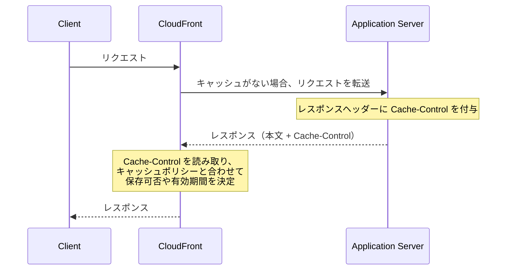

# HTTP header

## Cache-Control



https://developer.mozilla.org/en-US/docs/Web/HTTP/Reference/Headers/Cache-Control#directives

レスポンスヘッダーに関しては、アプリケーションサーバーにて値が設定される。

# CloudFront

https://docs.aws.amazon.com/ja_jp/AmazonCloudFront/latest/DeveloperGuide/adding-cloudfront-headers.html#cloudfront-headers-viewer-location

ここでいうビューワーというのは、CloudFront にリクエストを送るクライアントのこと。

`CloudFront-Viewer-Address`

> ビューワーの IP アドレスと、リクエストのソースポートを示します。例えば、198.51.100.10:46532 のヘッダー値は、ビューワーの IP アドレスが 198.51.100.10 で、リクエストのソースポートが 46532 であることを意味します。

とのこと。

# Terraform

今回は CloudFront で OGP 画像[^OpenGraphProtoclの略。例えばSlackにURLを貼ると、画像とタイトルがついたプレビューが表示されると思う。その画像のこと。]をキャッシュする際の設定を Terraform 側で指定した。

```hcl
resource "aws_cloudfront_cache_policy" "og_images" {
  name        = "some-name"
  comment     = "Some comments."

  min_ttl     = 0
  default_ttl = 86400
  max_ttl     = 3153600

  parameters_in_cache_key_and_forwarde_to_origin {
    cookies_config {
      cookie_behavior = "none"
    }
    headers_config {
      header_behavior = "none"
    }
    query_strings_config {
      query_string_behavior = "none"
    }
  }
}
```

`Cache-Control: max-age=100000000` を設定しても、CloudFront のキャッシュ有効期間は `max_ttl` の `3153600` 秒に制限される。`s-maxage` も指定されている場合は、そちらの値が優先され、同じ上限が適用される。`max-age`、`s-maxage`、`Expires` による有効期間の指定がなければ、`default_ttl` が使われる。

今回 `min_ttl` を `0` にしたのは、アプリケーションサーバーが `Cache-Control: no-store` を返した際に、CloudFront でのキャッシュを防ぐため。例えば `min_ttl` が `10` の場合は、`no-store` を返しても CloudFront は最低 10 秒間キャッシュする。
