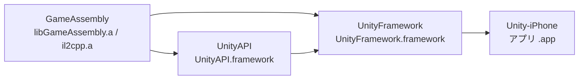

# Unity

## Build Pipeline

Unity プロジェクトのビルドについての理解を深めるべく学習した記録。

### iOS

大きく Unity ビルドと Xcode ビルドに工程を分けることができる。まずは Unity ビルドから説明していく。

これまで `batchmode` という Unity Editor をヘッドレスで利用するモードを用いてビルドしていたが、今や `unity-cli` を利用してビルドすることができる。

```bash
unity build --profile iOS -o Builds/Unity7/iOS-Swift
```

https://docs.unity.com/en-us/engine/7000.0/manual/programming-environment/scripting-backends/il2cpp/il2cpp-introduction#how-il2cpp-works

ここにもあるように、C# のソースコードは `Roslyn` コンパイラーによって DLL (`IL` が中に記述されている) へとコンパイルされる。このプロセスをもう少し詳細に分類すると下記のようになる。

|対象|Roslyn での扱い|
|-|-|
|ユーザーが作成した `.cs`|`Assembly-CSharp.dll` や {asmdef name}.dll へとコンパイル|
|パッケージに含まれる `.cs`|RectPop.dll などへコンパイル|
|`MonoBehaviour` などの `Unity DLL`|型・メソッドの情報を参照|
|`System.*` などの `.NET DLL`|型・メソッドの情報を参照|

またこれらの DLL にはストリッピングがかかる。

https://docs.unity.com/en-us/engine/7000.0/manual/programming-environment/script-compilation/managed-code-stripping

これのおかげでビルドサイズが小さく保てる。

そして、残った IL は `IL2CPP` によって `C++` へとコンパイルされる。

```bash
.
├── CompileFlowLab.xcodeproj
├── Data
├── Frameworks
├── Il2CppOutputProject
├── MainApp
├── process_symbols.sh
├── process_symbols_il2cpp.sh
├── TrampolineTests
├── unity-build.provenance.json
├── UnityAPI
└── UnityFramework
```

これは実際に `unity build` によって出力された file tree。今回は Unity `7000.0.0a12` で、Swift 形式の Xcode プロジェクトを出力した。以下はこの生成物を確認した記録で、Unity のバージョンやプロジェクト形式によって構成は変わる。

それぞれどういったものが入っているかは下記の通り。

#### CompileFlowLab.xcodeproj

何をコンパイルし、何をリンクし、どのファイルを完成したアプリに入れるかの設定。実際の設定は主に `project.pbxproj` に記述されている。

C++ や Objective-C++ のコードは Clang、Swift のコードは Swift コンパイラーでコンパイルする。ヘッダーやライブラリの検索先、コンパイル時のオプションなどもここで指定する。

#### Il2CppOutputProject

元が C# だったコードを変換した C++ と、それを動かす IL2CPP ランタイムのソース、ビルドツールが入っている。

```text
Il2CppOutputProject/
├── Source/
│   └── il2cppOutput/
│       ├── Assembly-CSharp.cpp
│       ├── UnityEngine.CoreModule__1.cpp
│       ├── System.Private.CoreLib.cpp
│       └── ...
└── IL2CPP/
    ├── build/
    ├── libil2cpp/
    │   └── gc/BoehmGC.cpp
    └── external/
        └── bdwgc/
```

`Source/il2cppOutput/` が、ストリッピング後の DLL を C++ へ変換したもの。自作のコードは `Assembly-CSharp.cpp` などに入り、必要な Unity の C# 側のコード (e.g. MonoBehaviour) や .NET のコード (e.g. System.*) も変換される。ひとつの DLL から生成される C++ は、複数ファイルに分割されることもある。

`IL2CPP/libil2cpp/` は、変換後のコードを動かすためのランタイム。オブジェクトや型の管理、例外処理、GC との連携などを担う。

#### UnityAPI

iOS のアプリとして Unity を動かすためのコード。ゲームを使っているときの操作と対応させると、何をしているのかがわかりやすい。

|操作|処理|
|-|-|
|アプリを開きゲーム画面が表示される|`UnitySceneDelegate.swift` が iOS のウィンドウを作り、Unity の表示用ビューを載せる|
|画面に触れる|`UnityView.swift` が iOS のタッチ通知を受け Unity 側へ渡す|
|画面更新のタイミングが来る|`MetalRenderer.swift` などが Unity のプレイヤーループを呼び出す|
|アプリが操作対象でなくなる、再び操作対象になる|`UnityPlayer.swift` が状態や設定に応じて一時停止・再開する|
|iPhone のキーボードで文字を入力する|`Features/Keyboard/` のコードが `UITextField` や `UITextView` を扱う|

たとえば、実際の `UnityView.swift` にあるタッチ開始の処理はこれ。

```swift
override func touchesBegan(_ touches: Set<UITouch>, with event: UIEvent?) {
    UnitySendTouches(.began, touches, event)
}
```

iOS が検知したタッチを Unity へ渡している。

Swift や Objective-C のアプリ・プラグインから Unity を操作する公開 API も含まれる。`UnityPlayer.shared.pause()` で一時停止でき、`sendMessage(toGameObject:method:argument:)` で指定した GameObject の C# スクリプトへメッセージを送れる。公開 API に加え、先ほどのタッチ転送のような内部実装もこのフォルダーに入っている。

Xcode では、このコードから静的な `UnityAPI.framework` を作る。`UnityAPI` ターゲットは Swift 形式のプロジェクトで生成される。

[Unity の公開 API リファレンス](https://docs.unity.com/en-us/engine/7000.0/manual/platform-specific/iphone/ios-developing/ios-swift-xcode-project-type/ios-swift-api-reference)

#### UnityFramework

アプリに組み込む `UnityFramework.framework` の公開用コード、設定ファイル、基盤ライブラリなどが入っている。今回の出力にある Swift ソースは、`UnityAPIExport.swift` の 1 行だけだった。

```swift
@_exported import UnityAPI
```

`UnityFramework` を import した Swift コードから、`UnityAPI` の公開 API も利用できるようにする記述。

|ファイル|役割|
|-|-|
|`UnityFramework.h`|バージョン情報の宣言や共通ヘッダーの読み込み|
|`Info.plist`|この framework の識別子、名前、バージョンなどの設定|
|`PrivacyInfo.xcprivacy`|使用する特定の Apple API と、その使用理由などの宣言|
|`Libraries/baselib.a`|スレッド、ロック、メモリ操作など、Unity の低レベル基盤のコンパイル済みライブラリ|
|`Prefix/`|コンパイル時に読み込む共通ヘッダーやマクロ定義|

#### Frameworks

Unity が提供するコンパイル済みのエンジン本体である `UnityRuntime.framework` が入っている。今回の `UnityRuntime.framework/UnityRuntime` は、`file` コマンドで `current ar archive` と判定された。静的ライブラリを含む framework ということになる。

`MonoBehaviour` を例にすると、C# 側の API とエンジン側のネイティブ実装に分かれる。前者の必要な部分は IL2CPP で C++ へ変換され、`libGameAssembly.a` に入る。後者は Unity が提供する `UnityRuntime.framework` に含まれる。

実際に `nm -C` でバイナリを調べると、`MonoBehaviour::Update()` や `MonoBehaviour::FixedUpdate()`、`MonoBehaviour::StartCoroutineManaged2(...)` の実装が見つかった。

通常の描画フレームでの関係を省略して書くと、下記のようになる。

```text
iOS の画面更新通知
  UnityAPI の描画用コード
    UnityPlayerLoop()                  ← UnityRuntime.framework
      MonoBehaviour の更新処理        ← UnityRuntime.framework
        自作スクリプトの Update()     ← libGameAssembly.a
```

名前が似ているが、`UnityFramework/` は公開用コードや設定などの置き場、`Frameworks/UnityRuntime.framework` は Unity 提供のエンジン、`UnityFramework.framework` は Xcode ビルドで作る成果物。

[Unity の Swift 形式の Xcode プロジェクト構造](https://docs.unity.com/en-us/engine/7000.0/manual/platform-specific/iphone/ios-developing/ios-swift-xcode-project-type/ios-structure-of-swift-xcode-project)

#### Data

ビルド済みのシーンやアセット、設定、実行時メタデータなどが入る。元が Unity YAML だったシーンやアセットも、Player 向けのビルドでは Unity 独自のバイナリのシリアライズ形式である `SerializedFile` になる。

|ファイル|内容・形式|
|-|-|
|`level0`|最初のシーンの GameObject やコンポーネント。バイナリの `SerializedFile`|
|`sharedassets0.assets`|シーンから参照するアセットのオブジェクト情報。バイナリの `SerializedFile`|
|`sharedassets0.assets.resS`|テクスチャやメッシュなどの実データを別に保存するバイナリファイル|
|`globalgamemanagers`|Quality、Graphics、Physics、タグ・レイヤーなどの設定。バイナリの `SerializedFile`|
|`Managed/Metadata/global-metadata.dat`|IL2CPP 用の型・メソッドなどのメタデータ|

Inspector で設定した値や GameObject の親子関係は、シーンなどのシリアライズされたデータに含まれる。テクスチャや音声など、元から YAML 以外のアセットもビルド対象になる。

また、`Data/` には `boot.config` のようなテキストの設定や、`ScriptingAssemblies.json` などの JSON も入っている。

[Unity のデータ形式の説明](https://docs.unity.com/en-us/engine/7000.0/manual/assets-and-media/assets-optimizing/assets-analyze-built-assets)、[ビルド後のコンテンツ構成](https://docs.unity.com/en-us/engine/7000.0/manual/building-and-publishing/build-content-output)

#### MainApp

iOS アプリの起動入口と、アプリ名、アイコン、起動画面などの設定が入っている。`MainApp.swift` には `@main` があり、Swift アプリとしてここから実行が始まる。

`Info.plist` は、アプリの識別子や起動・表示に関する情報を iOS に伝える設定ファイル。`plist` はキーと値でデータを表す形式で、今回の元ファイルは XML だった。

|キー|設定すること|
|-|-|
|`CFBundleIdentifier`|アプリの識別子。今回のファイルでは Xcode のビルド設定から値を入れる|
|`CFBundleDisplayName`|ホーム画面などに表示する名前。今回は `CompileFlowLab`|
|`CFBundleShortVersionString`|アプリのバージョン。今回は `1.0`|
|`UISupportedInterfaceOrientations`|対応する画面の向き|
|`UILaunchStoryboardName`|起動直後に表示する画面の指定|

Unity の Player Settings で設定した名前や画面の向きなどが、生成時にここへ反映される。アプリのアイコンは `MainApp/Images.xcassets/AppIcon.appiconset/` に入っていた。

[Apple の Info.plist の説明](https://developer.apple.com/documentation/bundleresources/information-property-list)

#### Xcode Build

今回のターゲット間の依存関係を「先に作る側 -> それを使う側」で描くと、下記のようになる。



`GameAssembly` はC++. から `libGameAssembly.a` を、IL2CPP ランタイムから `il2cpp.a` を作るターゲット。実際の `project.pbxproj` には、IL2CPP に以下のような引数を渡すビルドスクリプトがあった。

```text
--compile-cpp
--generatedcppdir="Il2CppOutputProject/Source/il2cppOutput"
--outputpath="$CONFIGURATION_BUILD_DIR/libGameAssembly.a"
```

つまり、Unity が出力した C++ を、Xcode ビルドでネイティブライブラリへコンパイルする。その後、前述のライブラリや framework をリンクし、`Unity-iPhone` ターゲットが `MainApp/` のコードや `Data/` のリソースを含む `.app` を作る。

Unity ビルドが成功した段階で Xcode でのコンパイル・リンク・署名が残っている。生成された Xcode プロジェクトをビルドして署名することで、実機へ配布できるアプリになる。

[Unity の iOS ビルドフロー](https://docs.unity.com/en-us/engine/7000.0/manual/platform-specific/iphone/ios-introducing/how-unity-builds-ios-applications)、[Apple のターゲット依存関係の説明](https://developer.apple.com/documentation/xcode/configuring-a-new-target-in-your-project)

## RyuJIT

https://csharpstack.dev/02-runtime-and-clr/jit-and-tiered-compilation.html

LLM 記事だと思うが、概要を掴むには丁度良い。

RyuJIT は IL -> Native な JIT コンパイラ。`Tiered Compilation` という技術を利用している。


図にあるように、コンパイルは 2 段階に分かれている。1 段階目 (Tier 0) ではコンパイル速度を優先しているため、インライン化などの最適化は限定的。結果として実行速度に欠点を持つ。2 段階目 (Tier 1) では積極的に最適化を行う。結果として実行速度が上がる。

まず全部 Tier 0 コンパイルして、ホットパスだけバックグラウンドで Tier 1 コンパイルをするという流れ。

コンパイル時間と実行時間にトレードオフを持つということ。
